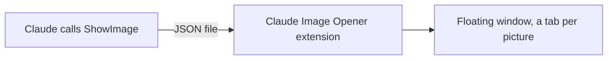

# vscode-images

Shows the pictures Claude wants you to see in a floating VS Code window, one tab each, while the keyboard stays in the terminal where Claude Code runs. Claude reads plenty of pictures for itself (checking a chart it just drew, say); only the ones it means for you open.



| Part | Runs on | Does |
| --- | --- | --- |
| Claude Code plugin (`hooks/register.ts`) | where Claude runs | A mod that gives Claude a `ShowImage` tool. Each call drops one small JSON file per picture into `~/.claude/vscode-images`, tagged with the window whose terminal runs the session |
| `claude-image-opener` (workspace extension) | VS Code server, where Claude runs | Watches that folder and opens the pictures meant for its window in a floating window: the first picture makes the window, later ones join it as tabs. Then it hands the keyboard back to the terminal |

The extension does what the `code` command cannot: `code --reuse-window picture.png` opens a tab too, but always moves the keyboard to it.

## Install

1. Install the Claude Code plugin where Claude runs:

   ```bash
   claude plugin marketplace add andytw366/claude-mods
   claude plugin install vscode-images@andytw366-mods
   ```

2. Install the extension from `dist/` (or build it, below) into the VS Code that runs Claude Code's terminal. From that terminal:

   ```bash
   code --install-extension ~/.claude/plugins/marketplaces/andytw366-mods/vscode-images/dist/claude-image-opener-0.2.0.vsix
   ```

3. Open a new terminal, so it carries the window's id, and start Claude Code there.

Building the extension:

```bash
cd vscode-images/vscode/opener && npx @vscode/vsce package --no-dependencies -o ../../dist/
```

## Requirements

- VS Code 1.86 or later (floating editor windows)
- Claude Code with mods

## Limits

- **The floating window takes the keyboard once.** When the first picture makes the window, the operating system focuses it, and VS Code has no command to bring the main window back to the front. Later pictures open in the existing window and leave the keyboard in the terminal. Keep the window open (move it to another screen, say) to avoid that.
- **Terminals opened before the extension started** have no window id. Pictures shown from them open only in windows whose workspace holds the picture, and Claude is told so.
- **Pictures VS Code previews:** PNG, JPEG, GIF, WebP, BMP, ICO and SVG.
