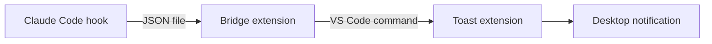

# vscode-notify

Desktop notifications on the computer you're sitting at when Claude Code finishes a turn or needs your permission, even when Claude runs somewhere else: WSL, a dev container, or a machine you reach over Remote-SSH.



| Part | Runs on | Does |
| --- | --- | --- |
| Claude Code plugin (`hooks/notify.sh`) | where Claude runs | On each prompt, `Stop` and permission prompt, copies the hook's raw JSON to `~/.claude/vscode-notify`, tagged with the window whose terminal runs the session. Needs only bash, so it runs in Git Bash on Windows too |
| `claude-notify-bridge` (workspace extension) | VS Code server, where Claude runs | Watches that folder, works out the turn's length, and calls `claudeNotify.toast` for sessions started in its window's terminals (or, if started elsewhere, inside its workspace) |
| `claude-notify-toast` (UI extension) | your local machine | Turns the event into the notification's words and shows it: Windows toast, macOS Notification Center, or `notify-send` on Linux |

VS Code routes the command between the two extension hosts itself, so no ports or servers are involved. Because the toast extension always runs on the client, the same setup notifies whichever computer you're working from: local, WSL, dev container, or Remote-SSH.

## Install

1. Install the Claude Code plugin where Claude runs:

   ```bash
   claude plugin marketplace add andytw366/claude-mods
   claude plugin install vscode-notify@andytw366-mods
   ```

2. Build the extensions (or take them from a release):

   ```bash
   cd vscode-notify/vscode/bridge && npx @vscode/vsce package --no-dependencies -o ../../dist/
   cd ../toast && npx @vscode/vsce package --no-dependencies -o ../../dist/
   ```

3. In VS Code, install both `.vsix` files (Extensions view → `...` → Install from VSIX). Install the toast extension on every computer you work from.

4. Run **Claude Notify: Send a test notification** (or **…'needs you' notification**) from the command palette.

## What the notification shows (Windows)

| Part | Done | Needs you |
| --- | --- | --- |
| Header | Claude Notify, with `icon.svg` | same |
| Picture on the left | `status-done.svg` (green tick) | `status-needs.svg` (yellow !) |
| Title | project folder name (long names cut in the middle) | same |
| Text | first meaningful line of Claude's reply, Markdown removed, short openers skipped | the prompt, translated when VS Code is in Chinese |
| Bottom line | `SSH: host · 3m 12s` (environment · time the turn took) | `SSH: host · Needs you` |
| Button, sound | none, default sound | **Switch to window**, reminder sound; stays on screen until handled |

Each session's newer notification replaces its older one in the notification center; two sessions in the same window keep one each. macOS and Linux show the same words with ✅ / 🔔 before the title.

## Settings

| Setting | Default | Meaning |
| --- | --- | --- |
| `claudeNotify.when` | `unfocused` | Notify only while the VS Code window isn't focused, or `always` |
| `claudeNotify.onlyThisWorkspace` | `true` | Only sessions started in this window's terminals; for sessions started elsewhere, those whose folder is inside this window's workspace |
| `claudeNotify.windowsAppName` | `Claude Notify` | App name on Windows notifications, shown with the extension's own icon. Empty: show them as Visual Studio Code |

## Notes

- On Windows, clicking a notification brings back the VS Code window it came from, including Remote-SSH and dev container windows. The first click may ask whether to let Claude Notify Toast open the link; tick "don't ask again".

- Claude must run on the same host as the window's VS Code server (the bridge reads `~/.claude` there). A window opened locally while Claude runs in a separate WSL or SSH terminal won't see the events.
- Sessions from the Claude desktop app are skipped; the app has its own notifications.
- A session started in a window's integrated terminal notifies that window only. Terminals opened before the bridge was installed or the window reloaded carry an old id and fall back to the folder check: two windows on the same folder then both notify. Reopen the terminal to fix it.
- Native Windows works too: Claude Code runs the hook in Git Bash, and both extensions run locally.
- If the toast extension is missing, the bridge falls back to a VS Code popup.
