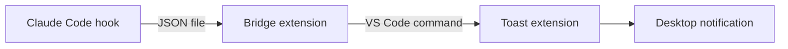

# vscode-notify

Desktop notifications on the computer you're sitting at when Claude Code finishes a turn or needs your permission, even when Claude runs somewhere else: WSL, a dev container, or a machine you reach over Remote-SSH.



| Part | Runs on | Does |
| --- | --- | --- |
| Claude Code plugin (`hooks/notify.sh`) | where Claude runs | On `Stop` and on permission prompts, writes a small JSON file to `~/.claude/vscode-notify` |
| `claude-notify-bridge` (workspace extension) | VS Code server, where Claude runs | Watches that folder and calls `claudeNotify.toast` for sessions inside its window's workspace |
| `claude-notify-toast` (UI extension) | your local machine | Shows a native notification: Windows toast, macOS Notification Center, or `notify-send` on Linux |

VS Code routes the command between the two extension hosts itself, so no ports or servers are involved. Because the toast extension always runs on the client, the same setup notifies whichever computer you're working from: local, WSL, dev container, or Remote-SSH.

## Install

1. Install the Claude Code plugin where Claude runs:

   ```bash
   claude plugin marketplace add andytw366/claude-mods
   claude plugin install vscode-notify@andytw366-mods
   ```

2. Build the extensions (or take them from a release):

   ```bash
   cd vscode-notify/vscode/bridge && npx @vscode/vsce package --no-dependencies -o ../../dist/
   cd ../toast && npx @vscode/vsce package --no-dependencies -o ../../dist/
   ```

3. In VS Code, install both `.vsix` files (Extensions view → `...` → Install from VSIX). Install the toast extension on every computer you work from.

4. Run **Claude Notify: Send a test notification** from the command palette.

## Settings

| Setting | Default | Meaning |
| --- | --- | --- |
| `claudeNotify.when` | `unfocused` | Notify only while the VS Code window isn't focused, or `always` |
| `claudeNotify.onlyThisWorkspace` | `true` | Only sessions whose folder is inside this window's workspace |
| `claudeNotify.windowsAppId` | Windows PowerShell | AppUserModelID the Windows toast is shown under |

## Notes

- Claude must run on the same host as the window's VS Code server (the bridge reads `~/.claude` there). A window opened locally while Claude runs in a separate WSL or SSH terminal won't see the events.
- Sessions from the Claude desktop app are skipped; the app has its own notifications.
- Two windows open on the same folder (say, one at home and one over SSH from a laptop) both get the notification.
- If the toast extension is missing, the bridge falls back to a VS Code popup.
